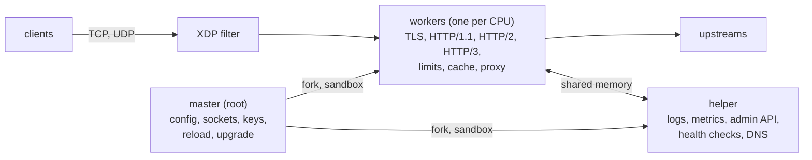

# Bastion

A Linux web server and reverse proxy in C, with HTTP/3, automatic certificates and sandboxed workers.

An HTTPS site with a certificate from Let's Encrypt, complete:

```conf
acme { email admin@example.com; }
server {
    name example.com www.example.com;
    tls auto;
    root /srv/www;
}
```

Every directive has a safe default, so these four directives are a whole configuration: the server
listens on 443 with HTTP/1.1 and HTTP/2, redirects port 80 to it, gets a certificate for both
names and renews it.

> **Status:** 1.0.0 release candidate, not yet published. Several conformance tools have not been
> run and only arm64 has been built. Read [Status and limits](#status-and-limits) before exposing
> it to the internet.

## Features

- **Protocols:** HTTP/1.1, HTTP/2 (TLS and h2c) and HTTP/3 over QUIC v1 and v2, all through the same
  router and handlers. WebSockets (also over HTTP/2), gRPC, server-sent events, 103 Early Hints.
- **TLS:** TLS 1.2 and 1.3 on OpenSSL 3.5, post-quantum hybrid key exchange first
  (`X25519MLKEM768`), kTLS, session tickets with rotation, OCSP stapling, 0-RTT with replay
  protection, mTLS, JA4 fingerprints.
- **ACME:** certificates from Let's Encrypt, ZeroSSL or any ACME CA, with HTTP-01, TLS-ALPN-01 or
  DNS-01 challenges and ARI-driven renewal, run in a short-lived sandboxed process.
- **Static files:** zero-copy sends, ranges, conditional requests, pre-compressed siblings,
  `try_files`, directory listings, an open file cache. Paths can never leave the root.
- **Reverse proxy:** upstream groups with round robin, least connections, peak EWMA and consistent
  hashing; active and passive health checks; retries with a budget; circuit breakers; HTTP/2 and
  TLS to upstreams; DNS re-resolution; PROXY protocol in and out.
- **Caching:** a shared disk cache with a RAM tier, stale-while-revalidate and stale-if-error,
  stampede locks, purge by tag or host.
- **Compression:** zstd, Brotli and gzip on the fly, BREACH-aware by default.
- **Protection:** ACLs, per-client connection limits, shared rate limits, WAF rules, a
  proof-of-work challenge page that can switch on by itself under attack, escalation from repeated
  refusals to blocks, and an XDP filter that drops floods in the network driver.
- **Authentication:** HTTP Basic with Argon2id, JWT (JWKS or PEM keys), forward auth, client
  certificates.
- **Operations:** reload and live binary upgrade with rollback, without dropping connections;
  Prometheus metrics; JSON or text access logs with redaction; an admin API over a Unix socket;
  `bastion doctor` to check a host; systemd `Type=notify` with watchdog and socket activation.
- **Isolation:** a root master that never reads client bytes; workers and a helper that drop to an
  unprivileged user, clear every capability and run under Landlock and per-role seccomp
  allowlists; io_uring rings restricted to the opcodes they need.

## Quick start

Build (needs Docker; everything runs in a Linux container):

```
git clone <this repository> bastion && cd bastion
./dev make BUILD=release            # static binary, build/release/bastion inside the container
./dev make test-unit                # optional: the unit tests
```

Try it without a configuration file:

```
bastion serve /srv/www --port 8080
bastion proxy http://127.0.0.1:3000 --port 8080
```

A configuration of your own, checked before you run it:

```conf
user bastion;
server {
    listen 8080;
    root /srv/www;
    location /api/ { proxy http://127.0.0.1:3000; }
}
```

```
bastion -t -c site.conf     # prints "configuration ok" or the error with file:line:col
bastion -c site.conf        # runs in the foreground; a supervisor daemonises it
```

The packages (`.deb`, `.rpm`) install a systemd unit, a default configuration at
`/etc/bastion/bastion.conf` and a `bastion` user. [Getting started](docs/guide/getting-started.md)
walks through a production HTTPS setup; [building](docs/building.md) covers the build in detail.

## Architecture



Text version: master (root) reads the configuration, binds every socket, loads keys and the XDP
program, then forks one worker per CPU and one helper. Workers handle all client traffic on an
io_uring (or epoll) event loop, under seccomp and Landlock. The helper writes logs, serves metrics
and the admin API, and runs health checks and DNS. They share counters, limits, the cache index
and log rings through shared memory. See [architecture](docs/architecture.md).

## Status and limits

Bastion 1.0.0 is a release candidate (the binary still reports `0.1.0`). Its gate results are in
[CHANGELOG.md](CHANGELOG.md). Known limits, from [conformance.md](docs/conformance.md#deviations-and-untested-areas-at-100)
and the changelog:

- **Not run:** h2spec, h3spec, quic-interop-runner and testssl.sh (their tests exist and skip
  without the tools); benchmarks against nginx on real hosts; a 72-hour soak; 24 CPU-hours of
  fuzzing per harness; the full seccomp minimality sweep; CodeQL outside CI.
- **CI** workflows are written but have never run on a runner. All gates ran in the `./dev`
  container on one arm64 machine.
- **amd64** artifacts have not been built or smoke-tested; only arm64 was built.
- **Untested:** `xdp mode hw` (no NIC with offload was available); kTLS only in the VM tests.
- `tls auto` does not open HTTP/3 or IPv6 listeners by itself: write them out.
- The packages do not include `docs/guide/`; the systemd unit's `systemd-analyze security` score
  is 3.8.
- The vulnerability contact in [SECURITY.md](SECURITY.md) is still a placeholder.

Linux 6.1 or later is required; it is the oldest kernel the VM tests boot.

## Documentation

The full index is [docs/README.md](docs/README.md).

| | |
|---|---|
| Start | [Getting started](docs/guide/getting-started.md), [quickstart recipes](docs/quickstart.md), [examples](examples/) |
| Guides | [Static sites](docs/guide/static-sites.md), [reverse proxy](docs/guide/reverse-proxy.md), [load balancing](docs/guide/load-balancing.md), [TLS](docs/guide/tls.md), [ACME](docs/guide/acme.md), [HTTP/3](docs/guide/http3.md), [caching](docs/guide/caching.md), [compression](docs/guide/compression.md), [access control](docs/guide/access-control.md), [DDoS protection](docs/guide/ddos.md), [XDP](docs/guide/xdp.md), [logging and metrics](docs/guide/logging-and-metrics.md), [reload and upgrade](docs/guide/reload-and-upgrade.md), [operations](docs/guide/operations.md), [migrating from nginx](docs/guide/migrating-from-nginx.md) |
| Reference | [Configuration](docs/configuration.md), [directive reference](docs/config-reference.md), [command line](docs/cli.md), [admin API](docs/admin-api.md), [systemd](docs/systemd.md), [tuning](docs/tuning.md), [challenge](docs/challenge.md), [troubleshooting](docs/troubleshooting.md), [FAQ](docs/faq.md) |
| Internals | [Architecture](docs/architecture.md), [building](docs/building.md), [testing](docs/testing.md), [conformance](docs/conformance.md), [threat model](docs/threat-model.md), [security review](docs/security.md), [third-party software](docs/third-party.md), [implementation plan](docs/implementation-plan/README.md) |

## Security

Bastion is designed for hostile networks, but it is young code. Report vulnerabilities as
[SECURITY.md](SECURITY.md) describes, never in a public issue. The [threat model](docs/threat-model.md)
says what the sandbox is meant to contain and which risks are accepted.

## Contributing

- Build and test through `./dev`; `./dev make` must stay warning-free (`-Werror`).
- Run the tiers your change touches: `./dev make test-unit`, `./dev make test-int`, and for
  documentation `./dev make test-int K=test_docs` ([testing](docs/testing.md)).
- A new or changed directive needs its table entry documented and `./dev make gen-reference`
  committed; `docs/config-reference.md` is generated, never edited by hand.
- New parsers get a fuzz harness in `fuzz/` ([fuzz/README.md](fuzz/README.md)).
- Configuration examples in the docs use a `conf` fence only when they are complete, and paths
  under `/srv/www` or `/etc/bastion` so the docs test can check them.

## License

MIT, see [LICENSE](LICENSE). Bundled third-party libraries keep their own licences
([third-party.md](docs/third-party.md)).
