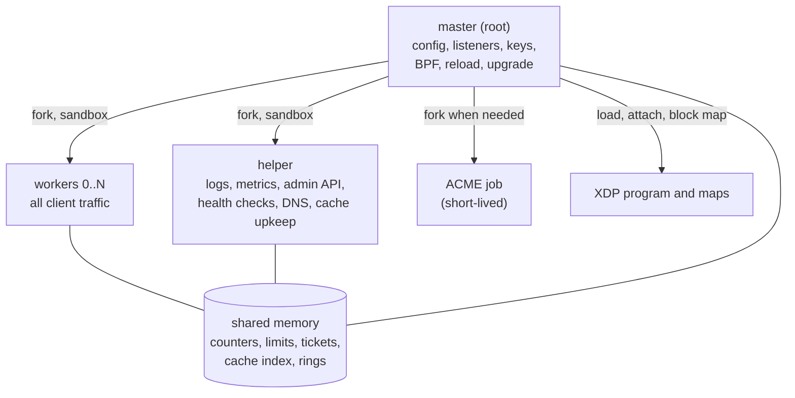
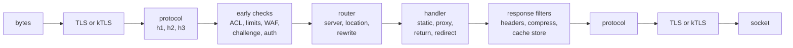
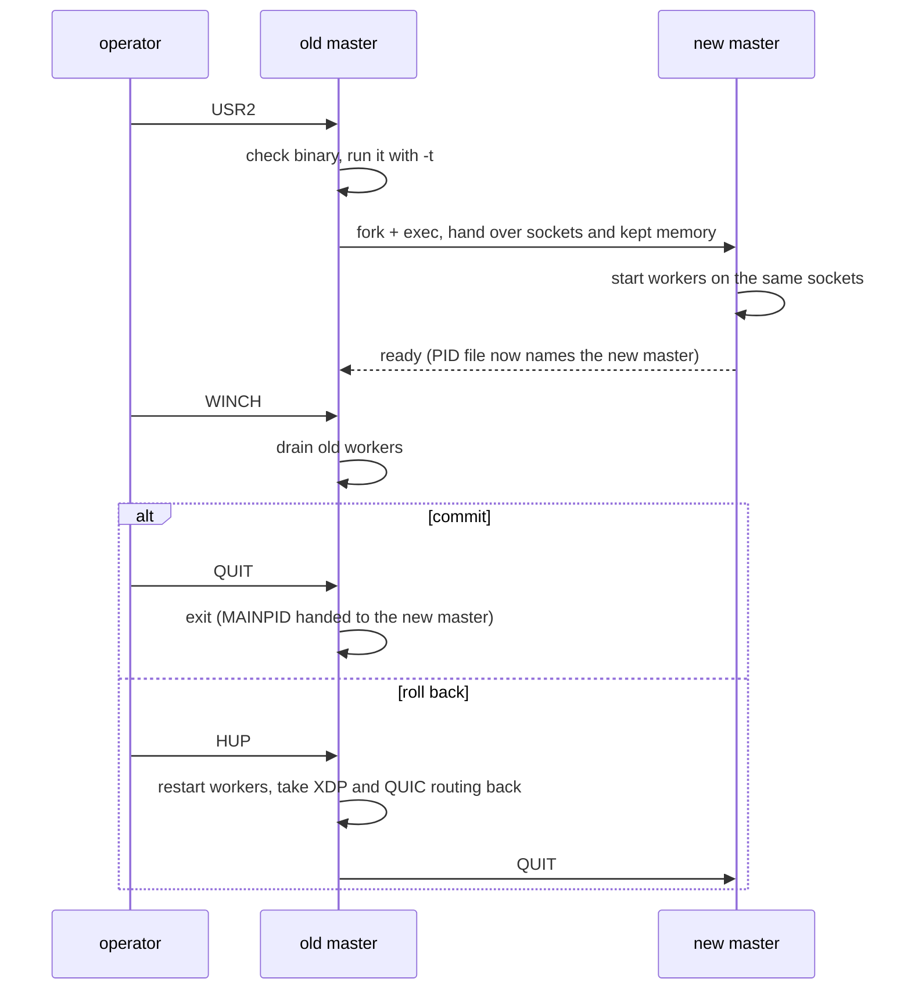

# Architecture

How Bastion is put together at run time: the processes, the event loop in each worker, the two I/O
backends, the disk thread pool, shared memory, reload and live upgrade, and the sandbox. This page
describes the binary as it is. The design it was built from, with the reasons for each choice, is
in [implementation-plan/architecture.md](implementation-plan/architecture.md). The source files
named here are the authority: most start with a header comment that states their contract.

## Processes



Text version: master forks the workers, the helper and (when certificates are due) an ACME job.
All of them map the same shared memory regions. Master alone loads the XDP program and writes its
block map.

| Process | Runs as | Does |
|---|---|---|
| master | root | Reads and compiles the configuration, binds every listening socket, loads TLS keys, loads the XDP and `sk_reuseport` BPF programs, supervises the children, runs reload and upgrade. It never reads from a client socket. Source: `src/proc/master.c`. |
| worker | `user` | One per CPU (`workers auto`) or as many as `workers` says. Accepts connections, terminates TLS, speaks HTTP/1.1, HTTP/2 and HTTP/3, applies limits, WAF rules, auth and the challenge, serves files and proxies. Workers share nothing but the shared memory regions. Source: `src/proc/worker.c`. |
| helper | `user` | One process with its own event loop for work that must exist only once: writing access logs, serving the metrics endpoint and the admin API, active health checks, DNS for `server ... resolve` upstreams, cache eviction and the purge table, OCSP fetches. Source: `src/proc/helper.c`. |
| ACME job | `user` | A short-lived child master forks to run the ACME protocol (`src/ops/acme.c`). It has the helper's sandbox. A new certificate is installed through a reload. |

**Supervision.** Master stays in a small `poll(2)` loop over a `signalfd` and one typed channel
(`SOCK_SEQPACKET`) per child (`src/proc/channel.h`). A malformed or out-of-place message gets its
sender killed, because a worker that sends one may be compromised. The first crash of a child is
respawned at once; further crashes back off exponentially, and a child that ran long enough
counts from one again (`BST_RESPAWN_*` in `src/proc/master.h`). `bastion_child_crashes_total` and
`bastion_worker_restarts_total` count them.

**Startup.** A child that cannot start at all makes master exit with status 1 instead of
crash-looping. Startup lasts until every child, the helper included, reports ready.

**Children watch master.** Each child sets `PR_SET_PDEATHSIG` and also sees EOF on its channel,
so it exits when master dies. Workers and the helper ignore the operator signals and take orders
over the channel, so a signal sent to the whole process group still goes through master.

## Listeners and accept queues

Master creates one socket per worker slot for every TCP listener, with `SO_REUSEPORT`, and keeps
a copy of each. Because master holds the socket, connections queued for a slot survive the death
of its worker: they wait in the queue until the replacement starts. A listener's socket options
come from its `tcp_profile` (see [tuning](tuning.md) and the
[reference](config-reference.md#tcp_profile)).

`limits` protects each worker from overload: `max_connections` caps open connections,
`worker_memory` caps request state (past it new requests get `overload_status`, 503 by default,
with `Retry-After`), and `reserve_fds` lets a worker that ran out of descriptors accept and close
waiting connections instead of leaving them in the queue.

HTTP/3 listeners are UDP sockets. QUIC packets for an existing connection must reach the worker
that holds it, even after the client's address changes, so the server's connection IDs carry the
worker slot. With `quic_routing ebpf` (the default) master attaches an `sk_reuseport` program
that reads the slot from the destination connection ID. Without `CAP_BPF` and `CAP_NET_ADMIN` it
logs a warning and falls back to `quic_routing hash`. See [HTTP/3](guide/http3.md).

## The worker event loop

Each worker runs one event loop on one thread (`src/io/loop.h`). Everything a connection does
(accept, TLS, parsing, routing, handlers, upstream connections, timers) runs as callbacks on that
loop. Nothing above `src/io/` calls `epoll_*` or `io_uring_*` directly: the loop offers a
completion-style API (accept, receive, send, connect, one-shot readiness, timers on a timer wheel),
which io_uring implements directly and epoll emulates with non-blocking calls on readiness.

A request moves through these layers:



Text version: bytes, TLS, protocol (HTTP/1.1, HTTP/2 or HTTP/3), early checks (ACL, limits, WAF,
challenge, auth), router (server, location, rewrite), handler (static, proxy, return, redirect),
response filters (headers, compression, cache store), then back out through the protocol and TLS.

Protocols and handlers meet only through a stream object (`src/http/stream.h`), so every handler
works on every protocol. Backpressure is explicit: a handler produces more body only when the
previous send completed, and request body bytes arrive only after the handler grants credit. No
layer buffers without a bound.

Memory on the request path comes from per-connection and per-request arenas and from slabs of
fixed-size objects (`src/core/arena.c`, `src/core/slab.c`). mimalloc is the general allocator; it
replaces `malloc` itself only in release and musltest builds (see [building](building.md)).

## I/O backends

`io { backend auto; }` (the default) picks io_uring and falls back to epoll when io_uring is not
available: `ENOSYS`, `EPERM` from seccomp or `kernel.io_uring_disabled`, or a missing opcode.
`backend uring` makes that a startup error, `backend epoll` never tries io_uring. The choice and
its reason are logged at start and printed by `bastion -t`:

```
io backend: uring (flags SINGLE_ISSUER,DEFER_TASKRUN,COOP_TASKRUN; NAPI off)
```

Every worker runs the same backend. If one worker falls back under `backend auto`, master moves
all of them to epoll by a graceful replacement. `bastion_io_backend{name}` shows which backend
the event loops run on.

| | io_uring | epoll |
|---|---|---|
| Accept | multishot accept | `accept4` on readiness |
| Receive | multishot receive into one provided-buffer ring per loop (`uring_bufs`, 16 KiB each) | `recv` on readiness |
| UDP (QUIC) | multishot `RECVMSG` into 64 KiB slots, chained `SENDMSG`, GSO and GRO | `recvmmsg` and `sendmmsg`, GSO and GRO |
| File reads | `IORING_OP_READ`, `OPENAT2`, `STATX` | `preadv2(RWF_NOWAIT)`, the thread pool on `EAGAIN` |
| Zero-copy file send | `IORING_OP_SPLICE` through a per-worker pipe pool | `sendfile`, with `readahead` on the pool first when pages are not resident |
| Busy polling | `uring_napi on` (Linux 6.9) | `epoll_busy_poll` (Linux 6.9) |
| Optional | `uring_sqpoll`, `uring_send_zc_min` | |

io_uring operations are not system calls, so seccomp cannot filter them. Rings are therefore
created disabled and locked with `IORING_REGISTER_RESTRICTIONS` to the exact opcodes a worker
needs before they are enabled. The `io` directives are listed in the
[reference](config-reference.md#io); [tuning](tuning.md) says when to change them.

## The disk thread pool

Each worker has a fixed pool of threads for blocking work (`src/io/aio.h`): file reads that would
block, `readahead`, password hashing for `auth_basic`, spooled request and response bodies, cache
writes and HTTP/3 file reads. The loop thread queues a job, a pool thread runs it, and the result
comes back to the loop thread as a callback. The event loop never waits for the disk.

- `aio_threads` sets the pool size; `auto` is the CPU count, at most 8. Each thread has a 256 KiB
  stack.
- `aio_queue` bounds the jobs queued, running or awaiting completion (default 256). Past it a job
  is refused with `EAGAIN` instead of growing memory.
- The pool starts before the sandbox, because seccomp later forbids creating threads. The sandbox
  steps are then applied on every pool thread too.

On shutdown, every accepted job finishes and its completion runs: no queued cache write is lost
on a graceful or fast stop.

## Shared memory

Every region is an anonymous `memfd` that master creates and maps before forking, with its size
sealed (`src/core/shm.h`). Regions use atomics and compare-and-swap only, never a process-shared
mutex, because a crashed worker would hold a mutex forever.

| Region | Contents | Survives a reload? |
|---|---|---|
| counters | per-process counters and histograms for `metrics {}` | yes |
| limits | `limit_zone` GCRA tables, `limit_conn` counters | no: the layout follows the configuration |
| tickets | TLS session ticket keys, locked in memory and kept out of core dumps | yes |
| block table | escalation and admin API blocks, with their TTLs | yes |
| cache index | the `cache_store` index, stampede locks, the tag purge table | no: disk objects stay, the index starts fresh |
| upstream state | health, ejection and resolved addresses, published by the helper | no |
| log rings | one single-producer ring per worker, read by the helper | no: each generation gets new rings |
| block ring | block requests from workers to master | no |

Access logs never block a worker: a worker writes a line into its ring and the helper drains the
rings every `log_flush_interval`. A line that does not fit while the helper is behind is dropped
and counted in `bastion_log_dropped_total`.

## Reload

A reload (`SIGHUP`, `systemctl reload`, `bastionctl reload`) runs the whole startup again in a
fresh image of the same binary, with the same PID (`src/proc/reload.h`):

1. **Validate.** The running binary checks the new configuration with `-t` in a child. If it fails,
   the error is logged, nothing changes and the old generation keeps serving.
   `bastion_config_reload_success` becomes 0.
2. **Hand over.** Master puts into the environment of the new image every listening socket, the
   PID file and its lock, the shared memory that must survive (ticket keys, the block table) and
   every running child with its channel.
3. **Re-execute.** `execve(/proc/self/exe)` with the original arguments. The PID does not change,
   so systemd, a container's PID 1 and the PID file are not disturbed.
4. **Switch over.** The new image starts a new generation of workers on the inherited sockets. An
   address that did not change never stops accepting, because it is the same socket. When every
   new child is ready, the old generation drains: it stops accepting and finishes what is in
   flight within `shutdown_timeout`, then anything left is killed.

What carries over: the metrics counters, the TLS ticket keys and the block table. What does not:
rate limit zones, the cache index and upstream health start fresh, because their layout follows
the configuration. A listener whose number of slots changed (a different `workers`)
gets new sockets, and connections still queued in the removed ones are reset. An XDP filter
pinned on bpffs (the default) is adopted without a gap. Runtime changes made through the admin
API (drains, maintenance, challenge override) are reset to the configuration; blocks keep their
TTL. The [reload and upgrade guide](guide/reload-and-upgrade.md) covers the operational side.

## Live upgrade

An upgrade (`SIGUSR2` or `bastionctl upgrade`) runs a new binary beside the old one, so a bad
binary can be rolled back with nothing lost (`src/proc/upgrade.h`):



Text version: `USR2` makes the old master check the binary at the path it was started from, run
it with `-t`, rename the PID file to `<pid>.oldbin` and start it as a child with the sockets and
kept shared memory. Both generations serve until the operator sends `WINCH` (drain the old
workers), then `QUIT` to commit or `HUP` to roll back.

The old master runs only the binary at its own start path, and only if it is a regular executable
owned by root or by master's user and writable by nobody else. A new master that fails (bad
configuration, crash at start, a state format it cannot read) is reaped by the old one, which
restores the PID file and its workers and keeps serving. `bastionctl upgrade -c <config>` runs
the whole sequence with timeouts and an optional TCP check, and rolls back by itself
([CLI](cli.md#bastionctl-upgrade)).

## The sandbox

Workers parse attacker-controlled input, so each worker and the helper confine themselves before
touching the network (`src/proc/sandbox.h`). Master stays outside the sandbox. The steps run in
this order:

1. Open every file, create the rings and shared memory, start the disk thread pool.
2. Optionally enter mount, PID, IPC and UTS namespaces (`namespaces on`, off by default).
3. Drop to `user` and `group`, then clear every capability set, the bounding set included
   (`drop_capabilities`, on by default).
4. Set `no_new_privs`, make the process non-dumpable and set `RLIMIT_CORE` to 0.
5. Apply Landlock (`landlock`, on by default): read-only access to the serving roots and
   `extra_read`, read-write access to the cache, temp and `extra_write` directories, nothing else.
6. Install the seccomp allowlist (`seccomp`, on by default): a per-role, per-architecture list of
   allowed system calls (`src/proc/seccomp_tables.c`), applied to every thread. Anything else
   kills the process; `seccomp log` records it in the kernel audit log instead, for debugging.

Thread and process creation are blocked by seccomp, which is why the pool starts in step 1. When
the kernel lacks Landlock or seccomp, or a namespace is not permitted, Bastion logs a warning and
starts; add `require` to the directive to make it a startup error. `bastion doctor` reports what
the kernel offers. The [threat model](threat-model.md) says what the sandbox is meant to contain,
and [security.md](security.md) records the review of the allowlist.

## Source layout

| Directory | Contents |
|---|---|
| `src/config/` | lexer, parser, directive registry, compiler, `-t` and `-T`, the CLI |
| `src/core/` | arenas, slabs, buffers, strings, hashing, JSON, logging, shared memory, timer wheel |
| `src/io/` | event loop, io_uring and epoll backends, sockets, listeners, UDP, the disk pool |
| `src/proc/` | master, workers, helper, channels, reload, upgrade, sandbox, seccomp, Landlock, systemd |
| `src/http/` | HTTP semantics, the stream layer, `h1/`, `h2/` and `h3/` (QUIC on ngtcp2 and nghttp3) |
| `src/tls/` | TLS contexts, SNI, tickets, OCSP, kTLS, 0-RTT, JA4 |
| `src/route/` | virtual hosts, locations, regexes, rewrites, variables |
| `src/handlers/` | static files, ranges, MIME types, autoindex, open file cache |
| `src/proxy/` | upstreams, balancing, health, retries, circuit breaker, HTTP/1.1 and HTTP/2 clients, tunnels, DNS, PROXY protocol |
| `src/cache/` | the HTTP cache: store, index, RAM tier, locks, eviction, purge |
| `src/filters/` | compression, headers, security headers, request ID, trace context, early hints, maintenance |
| `src/auth/` | Basic, JWT, JWKS, forward auth, mTLS |
| `src/sec/` | ACLs, rate and connection limits, WAF rules, challenge, escalation, attack detection |
| `src/xdp/` | the XDP program, its loader and stats, the QUIC `sk_reuseport` program |
| `src/ops/` | ACME, admin API, `bastionctl`, `doctor`, metrics, access logs, version |
